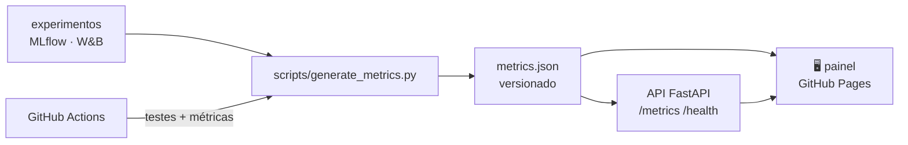

<<<<<<< HEAD
 <div align="center">

# 🧬 NEXUS·AI
### AI Engineering Research & Intelligence Lab

**From Mathematical Foundations to Production-Grade AI Systems**

A reproducible AI engineering research platform covering mathematical foundations, machine learning, deep learning, LLM applications, autonomous agents, LLMOps and AI security.

[](https://kallymeire.github.io/NEXUS.IA/)
[](https://github.com/kallymeire/NEXUS.IA)


</div>

---

## 🖥️ NEXUS·AI — Interactive Research Command Center

<div align="center">

**Explore the complete interactive AI engineering environment.**

<a href="https://kallymeire.github.io/NEXUS.IA/">
  
</a>

**[🚀 OPEN LIVE INTERACTIVE DASHBOARD](https://kallymeire.github.io/NEXUS.IA/)**

<sub>Interactive graphs · Training experiments · RAG benchmarks · Agent traces · AI security · Live Ops</sub>

</div>

---

## 🧠 Research Modules

| Module | Research Focus |
|:---|:---|
| 🧮 Foundations | Python, Linear Algebra, Probability, Statistics, Calculus, DSA |
| 🧠 ML & Deep Learning | Scikit-learn, Neural Networks, PyTorch, Transformers, Backpropagation |
| 🤖 LLM Applications | Prompt Engineering, Embeddings, RAG, Agents, Tool Calling |
| ⚙️ LLMOps | Evaluation, Monitoring, Cost, Latency, CI/CD |
| 🚀 Advanced AI | LoRA, QLoRA, Multimodal AI, Multi-Agent Systems |
| 🛡️ AI Security | Guardrails, Prompt Injection, Security Evaluation |
| 🧪 Portfolio | Structured Output Parser, Production RAG, Tool-using Agent |

---

## ⚡ Interactive Research Labs

The main dashboard includes nine interactive research environments:

| Lab | Capabilities |
|:---|:---|
| 🧭 Overview | Research overview and LLMOps metrics |
| 🕸️ Knowledge Graph | 58 topics, 7 modules and dependencies |
| 📈 Training Lab | MLP, CNN, Transformer, training curves and ablation |
| 🔎 RAG Lab | Retrieval experiments and Vector DB benchmarks |
| 🤖 Agents & Security | Agent execution traces and prompt-injection simulation |
| 🌌 Embedding Space | Interactive 3D embedding visualization |
| 📡 Live Ops | Simulated production traffic and autoscaling |
| 🧬 Attention Lab | Interactive attention matrix |
| 🏗️ Architecture | Research pipeline and system architecture |

---

## 📊 Engineering & Observability

- Training and validation loss.
- Validation accuracy.
- Vector retrieval recall and latency.
- RAG evaluation.
- Agent execution traces.
- Prompt-injection testing.
- LLMOps cost and latency monitoring.
- Production performance simulation.

---

## 🏗️ Project Architecture

```text
NEXUS.IA/
│
├── src/
│   └── nexus/
│       ├── foundations/
│       ├── ml_dl/
│       ├── llm_apps/
│       ├── llmops/
│       ├── advanced/
│       ├── tools/
│       └── portfolio/
│
├── docs/
│   ├── index.html          # Main interactive dashboard
│   ├── demo.gif            # Dashboard demonstration
│   ├── .nojekyll
│   │
│   └── dashboard/
│       ├── index.html      # Secondary dashboard
│       └── data/
│           └── metrics.json
│
├── scripts/
│   └── generate_metrics.py
│
├── .github/
│   └── workflows/
│       └── ci.yml
│
└── docker-compose.yml
```

---

## 🧪 Reproducible Research Protocol

Every research module follows a structured experimental methodology:

```text
HYPOTHESIS
    ↓
IMPLEMENTATION
    ↓
SEEDED EXPERIMENTS
    ↓
EVALUATION
    ↓
ABLATION STUDIES
    ↓
STATISTICAL SIGNIFICANCE
    ↓
TECHNICAL REPORT
```

Research practices include:

- Reproducible experiments with controlled seeds.
- Ablation studies.
- Mean and standard deviation analysis.
- Welch statistical significance tests.
- Evaluation metrics and technical reports.

---

## 🛠️ Technology Stack

| Category | Technologies |
|:---|:---|
| Language | Python |
| Machine Learning | Scikit-learn, PyTorch |
| LLM Ecosystem | Transformers, Hugging Face |
| RAG & Agents | LangChain, LangGraph, LlamaIndex |
| Vector Databases | Qdrant, Chroma, Pinecone, Weaviate |
| Backend | FastAPI |
| Observability | LangSmith, Phoenix |
| Experiment Tracking | MLflow, Weights & Biases |
| Infrastructure | Docker, Cloud, GitHub Actions |

---

## 🚀 Getting Started

### Main interactive dashboard

```bash
git clone https://github.com/kallymeire/NEXUS.IA.git

=======
<div align="center">

# 🧬 NEXUS·AI

**Laboratório de pesquisa em engenharia de IA: dos fundamentos matemáticos a sistemas em produção, com um centro de comando interativo.**

[](https://github.com/kallymeire/NEXUS.IA/actions)


[**▶ Ver o painel ao vivo**](https://kallymeire.github.io/NEXUS.IA/) · [Como funciona](#-como-funciona) · [Começar](#-começar-em-1-minuto) · [Roadmap](#-roadmap)

<a href="https://kallymeire.github.io/NEXUS.IA/">
  
</a>

</div>

---

## 💡 Por que isto existe

Estudar IA costuma virar uma pilha de notebooks soltos. Fica difícil responder: *o que eu já cobri? como um tópico depende de outro? o experimento é reproduzível?*

O NEXUS·AI organiza **58 tópicos em 7 módulos** (fundamentos, ML/DL, aplicações com LLMs, LLMOps, avançado, ferramentas e portfólio) e trata cada um como um experimento:

- **hipótese → implementação → testes → protocolo de avaliação → métricas**
- seeds controlados, ablação e teste de significância quando aplicável
- tudo visível em um painel que você abre no navegador, sem instalar nada

O resultado é um mapa navegável do que foi estudado, medido e publicado.

## 🖥️ O painel

Um centro de comando em HTML puro (sem build, sem framework) com nove laboratórios interativos.

| | |
|---|---|
| **Overview** | Cards de KPI que giram, com sparkline ao vivo. Universo de 30 dias de LLMOps em bolhas (timeline, radial, dispersão). Mapa orbital do protocolo de pesquisa por módulo. |
| **Knowledge Graph** | 58 tópicos, 7 módulos e dependências. Arraste, passe o mouse e clique para ver relações e marcar etapas do protocolo. |
| **Training Lab** | MLP, CNN e Transformer com learning rate e seed ajustáveis. Curvas de loss e acurácia, ablação com 5 seeds (média ± desvio) e teste de Welch. |
| **RAG Lab** | Benchmark de Vector DBs (Qdrant, Chroma, Pinecone, Weaviate) na fronteira de Pareto recall × latência. Busca híbrida com fusão BM25 + densa. |
| **Agents & Security** | Waterfall de spans de um agente, com replay. Ative o ataque de prompt injection e veja o guardrail bloquear. Evals com IC 95%. |
| **Embedding Space** | 420 chunks em 3D. Gire, dê zoom, clique em um ponto para rodar k-NN e ver a precisão da vizinhança. |
| **Live Ops** | Produção simulada em tempo real: injete falhas nos estágios, gere pico de tráfego e acompanhe p95 contra o SLO com autoscaling. |
| **Attention Lab** | Matriz de atenção por cabeça (prev token, self, lexical, causal) com temperatura ajustável. |
| **Architecture** | Pipeline de dados e automação e a estrutura proposta do repositório. |

**Paleta de comandos** com `Ctrl/⌘ + K` para saltar entre laboratórios, reproduzir o agent trace ou injetar um ataque. Tema claro e escuro, e funciona no celular.

## ⚙️ Como funciona



### Protocolo de pesquisa

Cada módulo segue a mesma metodologia:

```text
HIPÓTESE → IMPLEMENTAÇÃO → EXPERIMENTOS COM SEED → AVALIAÇÃO
        → ABLAÇÃO → SIGNIFICÂNCIA ESTATÍSTICA → RELATÓRIO TÉCNICO
```

### Módulos

| Módulo | Foco |
|---|---|
| 🧮 Foundations | Python, álgebra linear, probabilidade, cálculo, estruturas de dados, Git, APIs, SQL, Docker |
| 🧠 ML & Deep Learning | Scikit-learn, redes neurais, PyTorch, Transformers, backpropagation, Hugging Face |
| 🤖 LLM Applications | Prompt e context engineering, embeddings, RAG, tool calling, agentes, vector DBs, LangChain/LangGraph, LlamaIndex |
| ⚙️ Production & LLMOps | Evals, monitoramento, custo e latência, FastAPI, CI/CD para IA, guardrails, tracing |
| 🚀 Advanced | LoRA/QLoRA, modelos open source, vLLM, multimodal, multiagente, segurança de IA |
| 🛠️ Core Tools | Toolchain Python, stack PyTorch, ecossistema HF, LangSmith/Phoenix, MLflow/W&B |
| 🧪 Portfolio | Structured Output Parser, Production RAG App, Tool-using Agent, sistema com deploy |

## 🚀 Começar em 1 minuto

```bash
git clone https://github.com/kallymeire/NEXUS.IA.git
>>>>>>> c3e5b61 (docs: novo README com demo interativo do painel)
cd NEXUS.IA

python -m http.server 8080 -d docs
```

<<<<<<< HEAD
Open:

```text
http://localhost:8080
```

### Secondary dashboard metrics

```bash
python scripts/generate_metrics.py

python -m http.server 8081 -d docs/dashboard
```

### Docker

```bash
docker compose up --build
```

Services:

- API: `http://localhost:8000`
- Dashboard: `http://localhost:8080`

---

## ⚙️ Automation & CI/CD

GitHub Actions automates:

- Metrics generation.
- Test execution.
- Dashboard artifact generation.
- Continuous integration on repository updates.

---

## 🎯 Research Objectives

1. Mathematical foundations for machine learning.
2. Deep learning implementation and evaluation.
3. Production-oriented LLM application development.
4. Reproducible RAG and agent experimentation.
5. AI observability and system reliability.
6. AI security and responsible system design.

---

<div align="center">

## 🧬 Explore. Experiment. Engineer Intelligence.

**NEXUS·AI — Researching the Architecture of Intelligence.**

[](https://kallymeire.github.io/NEXUS.IA/)

<sub>Built for AI Engineering Research · Reproducibility · Production Systems</sub>

</div>
=======
Abra `http://localhost:8080` e navegue pelo painel. Não há build nem dependências.

Outras formas de rodar:

```bash
# métricas do painel secundário
python scripts/generate_metrics.py
python -m http.server 8081 -d docs/dashboard

# API + painel
docker compose up --build
```

| Serviço | Endereço |
|---|---|
| Painel | `http://localhost:8080` |
| API | `http://localhost:8000` |

### Publicando o seu progresso real

No `docs/index.html`, a constante `DONE` define o que está concluído. Edite e publique:

```js
const DONE = { 'rag': ['Hipótese', 'Implementação'] };
```

As etapas válidas são `Hipótese`, `Implementação`, `Testes`, `Eval protocol` e `Métricas`. O anel de progresso do Overview, o grafo e o card **Protocolo concluído** passam a refletir esse valor.

## 🗂️ Estrutura

```
NEXUS.IA/
├── src/nexus/
│   ├── foundations/ ml_dl/ llm_apps/
│   └── llmops/ advanced/ tools/ portfolio/
├── docs/                    # painel (publicado via GitHub Pages)
│   ├── index.html           # painel principal
│   ├── demo.gif · dashboard.png
│   ├── .nojekyll
│   └── dashboard/           # painel secundário
│       ├── index.html
│       └── data/metrics.json
├── scripts/generate_metrics.py
├── .github/workflows/ci.yml # CI: métricas, testes e artefato do painel
└── docker-compose.yml
```

## 🧭 Roadmap

- [x] Painel interativo com nove laboratórios e paleta de comandos
- [x] Grafo de conhecimento com 58 tópicos e dependências
- [x] Training Lab com seeds, ablação e teste de Welch
- [x] RAG Lab com fronteira de Pareto e busca híbrida
- [x] Agent trace com simulação de prompt injection e evals com IC 95%
- [x] Embedding Space 3D, Live Ops e Attention Lab
- [x] CI com geração de métricas e testes
- [ ] Trocar os dados simulados por execuções reais (MLflow / W&B)
- [ ] Traces reais de agentes via LangSmith / Phoenix
- [ ] Benchmark de Vector DBs medido, não modelado
- [ ] Relatórios técnicos por módulo (`research/reports/`)
- [ ] Comentário automático no Pull Request com as métricas

## ⚠️ Limitações

- **Os números do painel são simulados** (dados sintéticos com seed fixo). Treino, RAG, latência, custo e evals servem para demonstrar a visualização e o método, não para comparar produtos reais.
- O **retriever híbrido** é um modelo de brinquedo, feito para ilustrar a fusão lexical + densa.
- O **Embedding Space** é uma projeção sintética, não vem de um modelo de embeddings real.
- O progresso por tópico começa em 0% e só reflete o trabalho concluído depois que você edita `DONE`.
- A pilha tecnológica (LangChain, LangGraph, Qdrant, MLflow etc.) descreve o alvo de estudo, e nem todas as peças já têm implementação no repositório.

## 👩‍💻 Autora

**Kallymeire Coelho** · [GitHub](https://github.com/kallymeire)

## 📄 Licença

MIT. Veja [LICENSE](LICENSE).
>>>>>>> c3e5b61 (docs: novo README com demo interativo do painel)
