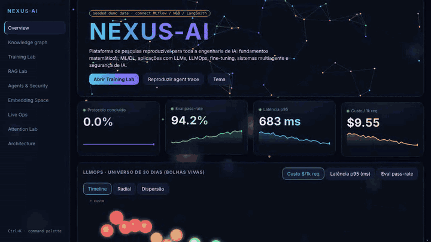

 <div align="center">

# 🧬 NEXUS·AI
### AI Engineering Research & Intelligence Lab

**From Mathematical Foundations to Production-Grade AI Systems**

A reproducible AI engineering research platform covering mathematical foundations, machine learning, deep learning, LLM applications, autonomous agents, LLMOps and AI security.

[](https://kallymeire.github.io/NEXUS.IA/)
[](https://github.com/kallymeire/NEXUS.IA)


</div>

---

## 🖥️ NEXUS·AI — Interactive Research Command Center

<div align="center">

**Explore the complete interactive AI engineering environment.**

<a href="https://kallymeire.github.io/NEXUS.IA/">
  
</a>

**[🚀 OPEN LIVE INTERACTIVE DASHBOARD](https://kallymeire.github.io/NEXUS.IA/)**

<sub>Interactive graphs · Training experiments · RAG benchmarks · Agent traces · AI security · Live Ops</sub>

</div>

---

## 🧠 Research Modules

| Module | Research Focus |
|:---|:---|
| 🧮 Foundations | Python, Linear Algebra, Probability, Statistics, Calculus, DSA |
| 🧠 ML & Deep Learning | Scikit-learn, Neural Networks, PyTorch, Transformers, Backpropagation |
| 🤖 LLM Applications | Prompt Engineering, Embeddings, RAG, Agents, Tool Calling |
| ⚙️ LLMOps | Evaluation, Monitoring, Cost, Latency, CI/CD |
| 🚀 Advanced AI | LoRA, QLoRA, Multimodal AI, Multi-Agent Systems |
| 🛡️ AI Security | Guardrails, Prompt Injection, Security Evaluation |
| 🧪 Portfolio | Structured Output Parser, Production RAG, Tool-using Agent |

---

## ⚡ Interactive Research Labs

The main dashboard includes nine interactive research environments:

| Lab | Capabilities |
|:---|:---|
| 🧭 Overview | Research overview and LLMOps metrics |
| 🕸️ Knowledge Graph | 58 topics, 7 modules and dependencies |
| 📈 Training Lab | MLP, CNN, Transformer, training curves and ablation |
| 🔎 RAG Lab | Retrieval experiments and Vector DB benchmarks |
| 🤖 Agents & Security | Agent execution traces and prompt-injection simulation |
| 🌌 Embedding Space | Interactive 3D embedding visualization |
| 📡 Live Ops | Simulated production traffic and autoscaling |
| 🧬 Attention Lab | Interactive attention matrix |
| 🏗️ Architecture | Research pipeline and system architecture |

---

## 📊 Engineering & Observability

- Training and validation loss.
- Validation accuracy.
- Vector retrieval recall and latency.
- RAG evaluation.
- Agent execution traces.
- Prompt-injection testing.
- LLMOps cost and latency monitoring.
- Production performance simulation.

---

## 🏗️ Project Architecture

```text
NEXUS.IA/
│
├── src/
│   └── nexus/
│       ├── foundations/
│       ├── ml_dl/
│       ├── llm_apps/
│       ├── llmops/
│       ├── advanced/
│       ├── tools/
│       └── portfolio/
│
├── docs/
│   ├── index.html          # Main interactive dashboard
│   ├── demo.gif            # Dashboard demonstration
│   ├── .nojekyll
│   │
│   └── dashboard/
│       ├── index.html      # Secondary dashboard
│       └── data/
│           └── metrics.json
│
├── scripts/
│   └── generate_metrics.py
│
├── .github/
│   └── workflows/
│       └── ci.yml
│
└── docker-compose.yml
```

---

## 🧪 Reproducible Research Protocol

Every research module follows a structured experimental methodology:

```text
HYPOTHESIS
    ↓
IMPLEMENTATION
    ↓
SEEDED EXPERIMENTS
    ↓
EVALUATION
    ↓
ABLATION STUDIES
    ↓
STATISTICAL SIGNIFICANCE
    ↓
TECHNICAL REPORT
```

Research practices include:

- Reproducible experiments with controlled seeds.
- Ablation studies.
- Mean and standard deviation analysis.
- Welch statistical significance tests.
- Evaluation metrics and technical reports.

---

## 🛠️ Technology Stack

| Category | Technologies |
|:---|:---|
| Language | Python |
| Machine Learning | Scikit-learn, PyTorch |
| LLM Ecosystem | Transformers, Hugging Face |
| RAG & Agents | LangChain, LangGraph, LlamaIndex |
| Vector Databases | Qdrant, Chroma, Pinecone, Weaviate |
| Backend | FastAPI |
| Observability | LangSmith, Phoenix |
| Experiment Tracking | MLflow, Weights & Biases |
| Infrastructure | Docker, Cloud, GitHub Actions |

---

## 🚀 Getting Started

### Main interactive dashboard

```bash
git clone https://github.com/kallymeire/NEXUS.IA.git

cd NEXUS.IA

python -m http.server 8080 -d docs
```

Open:

```text
http://localhost:8080
```

### Secondary dashboard metrics

```bash
python scripts/generate_metrics.py

python -m http.server 8081 -d docs/dashboard
```

### Docker

```bash
docker compose up --build
```

Services:

- API: `http://localhost:8000`
- Dashboard: `http://localhost:8080`

---

## ⚙️ Automation & CI/CD

GitHub Actions automates:

- Metrics generation.
- Test execution.
- Dashboard artifact generation.
- Continuous integration on repository updates.

---

## 🎯 Research Objectives

1. Mathematical foundations for machine learning.
2. Deep learning implementation and evaluation.
3. Production-oriented LLM application development.
4. Reproducible RAG and agent experimentation.
5. AI observability and system reliability.
6. AI security and responsible system design.

---

<div align="center">

## 🧬 Explore. Experiment. Engineer Intelligence.

**NEXUS·AI — Researching the Architecture of Intelligence.**

[](https://kallymeire.github.io/NEXUS.IA/)

<sub>Built for AI Engineering Research · Reproducibility · Production Systems</sub>

</div>
